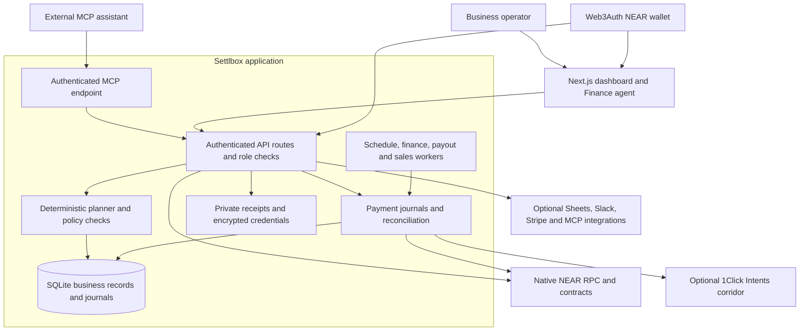

# Settlbox

Settlbox is a native-NEAR business finance workspace for treasury, invoices,
payroll, contractor payments, reimbursements, gifts and reviewed Finance-agent
actions. It uses NEAR accounts and six-decimal NEP-141 USDC, with Web3Auth for
human wallet actions and restricted NEAR function-call keys for
policy-approved treasury execution.

The current implementation is a native NEAR application and testnet-oriented
engineering project. Local setup, contract tests and provider observations do
not represent commercial availability, universal onboarding, live banking or
guaranteed yield. Provider configuration, wallet funding, contract deployment
and live settlement are separate from ordinary application startup.

## The problem

Businesses need more than a wallet balance. They need to know which invoices,
bills and payroll obligations are due, which funds are committed, which
payments are allowed by policy and which actions require a person to review or
sign.

Settlbox keeps those obligations, approvals and settlement evidence in one
workflow. Its focus is explainable payment preparation and traceable native
NEAR execution, not replacing every bank, accounting system or financial
provider.

## What the Finance agent decides

| Decision | Evidence and boundary |
| --- | --- |
| Which obligations need attention first | Uses saved records, due dates and workflow status to explain priorities. This is a deterministic application rule, not learned payment-timing optimization. |
| What cash is available for proposed payments | Uses configured native NEAR balances, existing commitments, liquidity protection and policy limits. Uncollected invoices are not spendable cash. |
| Which payments must stop or escalate | Checks recipients, roles, approvals, amount limits, daily capacity, liquidity and active reservations. Model output cannot override these checks. |
| Which business action to prepare | Resolves a supported operation from the conversation and saved context, then binds the proposal to the exact record and terms. |
| Whether execution can proceed | The server, journal and native contract recheck the saved payment, permissions and approvals. A worker can reconcile or execute an already-authorized action; it cannot create a human signature. |

The model explains and proposes. Deterministic validation, explicit review,
wallet authorization and contract rules enforce authority. The application does
not independently negotiate vendor terms, screen sanctions, infer milestone
completion or promise an investment return.

## How it works

1. Create an invoice, bill, contractor obligation, reimbursement or payment
   link, or import reviewed drafts from a supported integration.
2. Ask the Finance agent what needs attention. It explains due-date priorities,
   protected liquidity, eligible payments and blocked obligations from saved
   records.
3. Review the proposed action. Human wallet authorization and the applicable
   native treasury approvals remain required.
4. Execute or reconcile through native NEAR. Finalized receipts, authoritative
   NEP-141 token events and expected contract state determine whether settlement
   completed.
5. Inspect the saved business record, transaction evidence and audit history.
   Optional Slack notifications can publish structured updates when a verified
   settlement is recorded.

The optional NEAR Intents corridor supports a separate mainnet-only
Base-USDC-to-NEAR-USDC 1Click flow. A provider status is not treated as
payment; the destination NEAR receipt must independently prove the expected
transfer before the payment link is booked.

## Verified workflow and evidence

The repository includes native contract artifacts, sandbox results, provider
observations and local verification records. These documents describe what was
actually checked and what remains dependent on external accounts or providers:

- [Native local verification](docs/NEAR-LOCAL-VERIFICATION.json)
- [Native treasury runbook](docs/NEAR-TREASURY-RUNBOOK.md)
- [Workflow readiness audit](docs/workflow-readiness-audit.md)
- [Native contract artifacts](docs/NEAR-CONTRACT-ARTIFACTS.json)
- [Sandbox verification result](docs/NEAR-SANDBOX-RESULT.json)

The native sandbox and local test suites are engineering verification. They do
not prove customer adoption, commercial payment volume, provider availability
or a successful live payment for every workflow.

## Implemented capabilities

- **Wallet and access:** Web3Auth sign-in, signed workspace challenges,
  company-scoped records, roles, invitations and ownership checks.
- **Treasury:** native NEAR treasury bindings, restricted executor keys,
  recipient and amount policy, approval-controlled payments, durable journals,
  idempotent retries and final receipt reconciliation.
- **Invoices and collections:** saved invoices, printable documents, payment
  links, native NEAR USDC collection and settlement reconciliation.
- **Bills, contractors and payroll:** company-scoped records, groups, terms,
  payroll periods, recurring schedules and payable preparation. Scheduling does
  not bypass approval.
- **Reimbursements:** private receipt uploads, review, approval and canonical
  payable obligations with company-scoped storage.
- **Gifts:** native escrow contract support and gift records. Deployment and
  funding remain separate configuration steps.
- **Finance agent:** conversational analysis, deterministic planning, policy
  checks, reviewed proposals, saved conversations and an audit trail.
- **NEAR Intents:** a disabled-by-default, mainnet-only Base USDC to NEAR USDC
  1Click adapter with signed quote validation, persistent order state, status
  reconciliation, destination receipt verification and refund evidence checks.
- **Earn:** a guarded native Rhea adapter. Provider code approval and supported
  native USDC are required before execution; rates and historical records are
  not guarantees.
- **Integrations:** optional Google Sheets, Slack, Stripe, MCP and sandbox fiat
  workflows, each gated by its own configuration and provider boundaries.

Empty configuration does not make an integration operational. A visible screen
or mocked test response is not evidence that a provider is connected or that a
financial action can settle.

## Architecture

The dashboard, Finance agent and manual workflows share server-side
company-scoped records. The agent proposes supported operations; deterministic
policy checks, wallet approvals, native contracts and reconciliation determine
what can complete.



The company wallet, workspace collection account, reserve account and treasury
vault are separate identities or funding paths where configured. A dashboard
balance does not automatically represent every asset held by the business.

## Development: clone, configure and run

### 1. Install prerequisites and clone

Use **Node.js 24 or newer**, npm and Git. The application uses Node's built-in
SQLite API, so a separate SQLite service is not required.

```powershell
git clone https://github.com/i-mwangi/garment.git
cd garment
node --version
npm --version
npm ci
```

The repository `.npmrc` enables the peer-dependency resolution required by the
current lockfile.

Native contract checks additionally require Rust 1.93.0 and the
`wasm32-unknown-unknown` target. Windows builds also require Visual Studio C++
Build Tools, CMake and NASM. See [Windows contract setup](docs/WINDOWS-CONTRACT-SETUP.md).

### 2. Create the local environment

Do not overwrite an existing configured environment.

```powershell
Copy-Item .env.example .env.local
New-Item -ItemType Directory -Force .data
```

For a local server on port 3000, set these values in `.env.local`:

```dotenv
NEXT_PUBLIC_APP_URL=http://127.0.0.1:3000
NEXT_PUBLIC_SERVER_URL=http://127.0.0.1:3000
SETTLBOX_APP_ORIGIN=http://127.0.0.1:3000
NEXT_PUBLIC_NEAR_NETWORK=testnet
NEXT_PUBLIC_NEAR_RPC_URL=https://rpc.testnet.fastnear.com
```

Use the same hostname consistently. `localhost` and `127.0.0.1` are different
browser origins. Keep `.env.local`, `.data`, wallet credentials, private keys,
API tokens and uploaded receipts private.

Configure the public `NEXT_PUBLIC_WEB3AUTH_CLIENT_ID` for the local origin.
Generate private values for protected operator and worker routes with:

```powershell
node -e "console.log(require('node:crypto').randomBytes(32).toString('hex'))"
```

Copy the output privately into `SETTLBOX_OPERATOR_TOKEN` and
`SETTLBOX_FINANCE_WORKER_TOKEN`. Never put private keys or server credentials
in `NEXT_PUBLIC_*` variables.

### 3. Configure workspace sign-in

There are no shared default login credentials. The helper prompts for an email
and a password of at least 12 characters, then writes a salted password hash to
`.env.local` without storing the plaintext password:

```powershell
powershell -NoProfile -File scripts/configure-auth.ps1
```

### 4. Initialize a native NEAR workspace

Choose a NEAR account that you control. This creates the local company
identity, owner membership and empty business records. It refuses to overwrite
an existing identity for a different account or network.

```powershell
node --env-file-if-exists=.env.local --experimental-strip-types `
  scripts/setup-near-workspace.mjs your-account.testnet
```

Replace `your-account.testnet` with the actual testnet account ID. The local
workspace configuration is stored at `.data/near-treasury.json` by default.
This command does not create, fund or deploy an on-chain wallet.

To load the checked-in demo records after initialization:

```powershell
npm run seed:demo
```

Demo data is for exploration and testing only; it does not prove provider
connectivity or live settlement.

### 5. Run the development server

```powershell
npm run dev -- --hostname 127.0.0.1 --port 3000
```

Open [workspace login](http://127.0.0.1:3000/login), sign in with the
configured credentials, and explore the dashboard or Finance agent.

`npm run dev` starts the Next.js development server only. It does not start
the background workers used by the production launcher. To run the Finance
agent worker separately, configure its required settings and use a second
terminal:

```powershell
$env:PORT='3000'
npm run agent:worker
```

Do not run a duplicate worker alongside `npm start`.

### 6. Implemented capabilities

The following capabilities are implemented in the repository. Some require
provider credentials, wallet funding, approvals or deployment configuration
before they can be exercised locally or on a live network:

| Feature | Configuration and guidance |
| --- | --- |
| Finance agent | Set the selected AI provider and its server-only credentials. See [Finance chat](docs/finance-chat.md). |
| Native treasury | Prepare bindings, policy and restricted executor permissions. See [the treasury runbook](docs/NEAR-TREASURY-RUNBOOK.md). |
| NEAR Intents checkout | Requires mainnet, `SETTLBOX_BASE_USDC_CHECKOUT_ENABLED=true`, `SETTLBOX_1CLICK_JWT` and `FASTNEAR_API_KEY`. It is disabled by default and has no testnet swap path. |
| Google Sheets | Configure OAuth credentials, encryption and the exact callback URI. See [Sheets setup](docs/google-sheets-setup.md). |
| Slack and Stripe | Configure the server-only provider credentials. See [Slack and Stripe setup](docs/slack-stripe-setup.md). |
| MCP | Configure authentication and allowed origins. See [Inbound MCP](docs/inbound-mcp.md). |
| Fiat payouts | Kora remains a sandbox workflow. See [Fiat payouts](docs/fiat-payouts.md). |

### 7. Build and start production

Stop the existing server before rebuilding, especially on Windows where
generated standalone files can be locked. Preserve `.data` and `.env.local`.

```powershell
npm run build
$env:PORT='3000'
$env:HOSTNAME='127.0.0.1'
npm start
```

The build produces `.next/standalone`. The production launcher loads
`.env.local`, starts the standalone server and starts configured schedule,
Finance and payout-status workers. Rebuild after source changes before
restarting production.

## Verification

Run the application checks with:

```powershell
npm test
npm run typecheck
npm run test:near
npm run build
```

Native contract checks are separate:

```powershell
powershell -File scripts/near-contracts.ps1 -Action check
powershell -File scripts/near-contracts.ps1 -Action test
powershell -File scripts/near-contracts.ps1 -Action build
```

These commands compile or test locally. They do not deploy contracts, transfer
assets or establish live end-to-end settlement. Read the
[workflow readiness audit](docs/workflow-readiness-audit.md) for current
acceptance checks and external-provider limitations.

## Reliability and audit boundaries

Native settlement requires the original signed transaction, finalized
successful child receipts, authoritative NEP-141 token events and the expected
contract state. An HTTP success response, an outer transaction success or a
provider-reported status alone is not proof of payment.

The application records business decisions, proposals, journals and outcomes.
Those records are not an immutable event ledger or the model's private
reasoning. Transaction receipts provide separate settlement evidence.

SQLite databases, configuration, uploads and verification artifacts live under
`.data` by default. Preserve this directory and the integration encryption key
across restarts when using configured integrations. Distributed deployments
require shared transactional storage rather than independent local database
copies.

## Access-dependent and unfinished capabilities

- Native Earn requires approved provider code, supported native USDC and
  separately reviewed supply or withdrawal transactions. No fixed APY is
  promised.
- The NEAR Intents corridor is mainnet-only and disabled by default. It should
  not be represented as active without provider credentials, a reviewed
  low-value live check and final destination evidence.
- Gift escrow deployment, treasury funding, approvals and executor
  registration require separate accounts, permissions and on-chain
  verification.
- Kora payout workflows are sandbox-only. Banking, cards and unavailable
  external services are not represented as native NEAR transfers.
- Imported fixtures, historical migration records and provider observations
  retain their provenance and are not proof of current native settlement.

## Documentation

- [Documentation index](docs/README.md)
- [Native treasury runbook](docs/NEAR-TREASURY-RUNBOOK.md)
- [Windows contract setup](docs/WINDOWS-CONTRACT-SETUP.md)
- [Finance automation](docs/finance-automation.md)
- [Finance chat](docs/finance-chat.md)
- [Human wallet approvals](docs/human-wallet-approvals.md)
- [USYC integration boundaries](docs/usyc-integration.md)
- [Environment template](.env.example)
